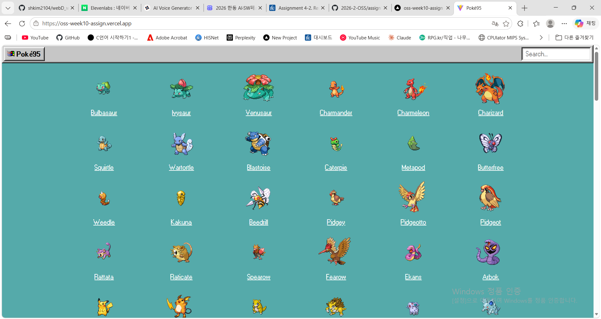

# React Open Source Project Customizing & Deployment

## 1. Project Information
### 프로젝트 소개
   - react 관련 오픈소스를 찾아서 직접 수정해보고 react에 관해서 알아보았습니다
   - 선택한 프로젝트 [Poké95](https://github.com/wobsoriano/poke95)는 React와 [React95](https://github.com/arturbien/React95) UI 라이브러리로 만든 Windows 95 스타일 포켓몬 도감입니다. 포켓몬 데이터는 [PokeAPI](https://pokeapi.co)에서 가져오므로 Backend나 Database 없이 실행됩니다.
   - 원본은 1세대 151마리만 보여주는데, 이를 **9세대 팔데아까지 전국도감(1025마리)** 으로 확장했습니다.
### 선택 이유
   - 포켓몬에 관한 주제를 선택한 이유는 단지, 재미있어 보였고, 게임분야에서 메타픽을 확실히 알 수 있는 그런 사이트를 직접 만들어 보고 싶었기 때문에 해보고 싶었습니다
### 주요 기능
   - 포켓몬에 대한 정보들을 확인 할 수 있습니다
   1. **포켓몬 목록**: 바탕화면 아이콘처럼 포켓몬 이미지와 이름을 격자로 표시
   2. **검색**: 상단 작업 표시줄의 검색창에 이름을 입력하면 목록이 실시간으로 필터링됨
   3. **상세 정보 창**: 포켓몬을 더블클릭(또는 Enter)하면 `Pokemon.exe` 창이 열리고, Basic Info(타입·키·몸무게·설명) / Stats / Abilities 탭으로 정보를 확인
### 원본 프로젝트
- GitHub URL: https://github.com/wobsoriano/poke95
- License: MIT License (Copyright (c) 2020 Robert C Soriano) — [LICENSE.md](./LICENSE.md)
- 사용 데이터: [PokeAPI v2](https://pokeapi.co)

## 2. Installation
### 설치 및 실행 방법
- 요구 사항: Node.js 18 이상

```bash
git clone https://github.com/2026-2-OSS/assign10-c01-22300133.git
cd assign10-c01-22300133
npm install
npm run dev
```
- 실행 후 터미널에 표시되는 주소(기본 `http://localhost:5173`)로 접속합니다.
- 패키지 간 peer dependency 버전 충돌로 `npm install`이 실패하여, `.npmrc`에 `legacy-peer-deps=true`를 추가했습니다.

### 실행 화면



## 3. Source Code Exploration
### Project Structure (주요 파일)
| 파일 | 역할 |
|---|---|
| `src/App.jsx` | 최상위 컴포넌트. 시작할 때 전체 포켓몬 목록을 불러오고, 작업 표시줄(메뉴·검색창)과 포켓몬 격자, 모달 창들을 배치합니다 |
| `src/api.js` | PokeAPI 호출 담당. `getAllPokemons()`는 목록을, `getPokemon(id)`는 특정 포켓몬의 상세 정보와 설명을 가져옵니다|
| `src/store/index.jsx` | `useReducer` + Context로 만든 전역 상태 저장소. 모달 열림 여부, 선택된 탭, 선택된 포켓몬 데이터 등을 관리합니다 |

### React Component
- **`Pokemon`** (`src/components/Pokemon.jsx`)
  목록의 포켓몬 한 칸을 그리는 컴포넌트입니다. 클릭하면 선택 표시(파란 배경)를 하고, 더블클릭하거나 Enter를 누르면 `getPokemon(id)`로 상세 정보를 받아 전역 상태에 저장한 뒤 상세 창을 엽니다. 이미지를 불러오는 동안에는 몬스터볼 이미지를 대신 보여줍니다.
- **`PokemonModal`** (`src/components/PokemonModal.jsx`)
  `Pokemon.exe` 상세 정보 창입니다. 전역 상태의 `selectedPokemon`을 읽어 Basic Info / Stats / Abilities 탭으로 나눠 보여주고, 타입별로 정해진 색(`typeColors`)으로 타입 배지를 표시합니다.

### Code Analysis
`src/api.js`의 `getPokemon` 함수
```js
const getPokemon = async pokemonId => {
  const [data, species] = await Promise.all([
    $fetch(`https://pokeapi.co/api/v2/pokemon/${pokemonId}`),
    $fetch(`https://pokeapi.co/api/v2/pokemon-species/${pokemonId}`),
  ]);

  const flavorTextEntry = species.flavor_text_entries.findIndex(i => {
    return i.language.name === 'ko' || i.language.name === 'en';
  });
  data.flavor_text = species.flavor_text_entries[flavorTextEntry].flavor_text;

  return data;
};
```
- 포켓몬의 기본 정보(`/pokemon`)와 종 정보(`/pokemon-species`)는 서로 다른 API에 있어서, `Promise.all`로 **두 요청을 동시에** 보내고 둘 다 끝날 때까지 기다립니다. 하나씩 순서대로 요청하는 것보다 빠릅니다.
- 종 정보의 `flavor_text_entries`에는 게임 버전·언어별 설명이 여러 개 들어 있습니다. `findIndex`로 한국어(`ko`) 또는 영어(`en`) 설명 중 **목록에서 먼저 나오는 것**의 위치를 찾습니다.
- 찾은 설명을 `data.flavor_text`에 붙여서 반환하면, `PokemonModal`의 Basic Info 탭이 이 값을 화면에 출력합니다.

## 4. Customizing
### Text
- 수정 파일: `index.html`
- 변경 전: `<title>Poké95</title>`
- 변경 후: `<title>전국도감</title>`
- 결과: 브라우저 탭 제목이 `Poké95` → `전국도감`으로 수정했습니다
### Style
- 수정 파일: `index.html`
- 변경 전: `<body style="background-color: #55AAAA;">` 
- 변경 후: `<body style="background-color: #186ab7f3">` (파란색)
- 결과: 포켓몬 목록 뒤 바탕화면 배경이 청록색 → 파란색으로 바뀌었습니다.
### UI/Data
- 수정 파일: `src/api.js`
- 변경 전: `https://pokeapi.co/api/v2/pokemon?limit=151` 
  1세대 151마리만 표시했었는데,
- 변경 후: `https://pokeapi.co/api/v2/pokemon?limit=1025` → 9세대 팔데아까지 1025마리 표시
- 결과: 목록과 검색에서 2~9세대 포켓몬도 볼 수 있습니다.

### (추가) 설명 표시 버그 수정
- 수정 파일: `src/api.js`
- 변경 전: `i.language.name === 'en' && i.version.name === 'y'` → 포켓몬 Y 버전의 영어 설명만 찾아서 수정했습니다
- 변경 후: `i.language.name === 'ko' || i.language.name === 'en'` → 버전과 상관없이 한국어 또는 영어 설명을 찾았습니다
- 이유: Y는 6세대 게임이라 그 이후에 나온 포켓몬은 Y 버전 설명이 없어서, 1025마리로 늘리자 일부 포켓몬의 정보가 나오지 않았음

## 5. Deployment
- Vercel URL: https://oss-week10-assign.vercel.app/
- GitHub : https://github.com/shkim2104/oss_week10_assign

## 6. Weekly Review
### 새롭게 배운 내용
1. **오픈소스 활용 흐름**: Clone → Run → Explore → Customize → Push → Deploy 과정을 직접 해보며, 다른 사람의 코드를 읽고 고쳐서 배포하는 방법을 익혔습니다
2. **`useReducer` + Context 전역 상태 관리**: 여러 컴포넌트(목록, 상세 창, 메뉴)가 같은 상태를 `dispatch`로 바꾸고 읽는 구조를 알게 되었습니다.
3. **외부 API 데이터 다루기**: `Promise.all`로 여러 요청을 동시에 처리하는 방법과, API 응답 구조(버전·언어별 설명 목록)를 확인하고 원하는 값을 골라내야 한다는 점을 배웠습니다.

### 어려웠던 점과 해결 방법
- **`npm install` 실패**: 오래된 패키지들 사이의 peer dependency 버전 충돌로 설치가 되지 않았아서 `.npmrc`에 `legacy-peer-deps=true`를 추가하고 `@babel/runtime`을 설치해서 해결했습니다.
- **6세대 이후 포켓몬 정보가 나오지 않음**: 1025마리로 늘린 뒤 일부 포켓몬은 설명이 나오지 않아서 Y 버전 설명만 찾는 조건이 원인인 것을 확인하고, 언어 기준으로 찾도록 조건을 바꿔서 해결했습니다.

### AI 활용 내용 및 느낀 점
- **AI 활용 내용**
  - 오류 원인 파악과 코드 이해에 AI(Claude Code)의 도움을 받음
  - 과제 요구사항 대비 빠진 항목 점검
- **직접 수행한 작업**
  - 프로젝트 선택, Clone 및 실행, 코드 수정(제목·배경색·포켓몬 수·설명 조건), 커밋 및 Push, Vercel 배포
- **느낀 점**
  - react 프로젝트에 대해서 알게 되었습니다.

## License & Credits
- 원본 프로젝트: [wobsoriano/poke95](https://github.com/wobsoriano/poke95) by Robert C Soriano
- License: [MIT](./LICENSE.md) 
- Built with: [React](https://reactjs.org), [React95](https://github.com/arturbien/React95), [PokeAPI](https://pokeapi.co), [Vercel](https://vercel.com)
